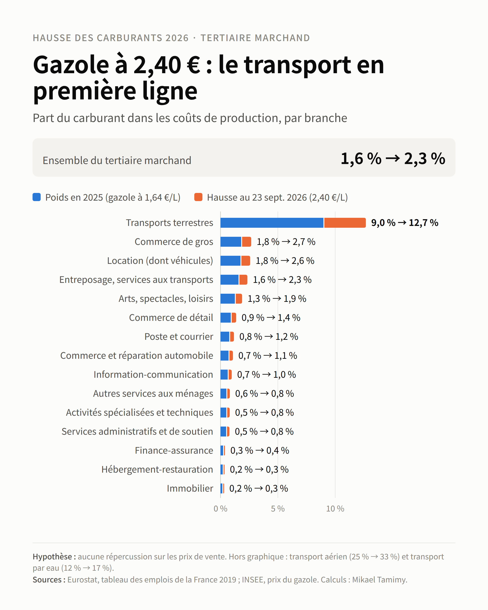

# ⛽ Hausse des Carburants 2026 — Quel impact sur le tertiaire ?


> Estimation, branche par branche, de ce que coûte la hausse du gazole de 2026 aux entreprises du tertiaire marchand en France.

**English summary.** Branch-level estimate of the 2026 diesel price shock on French market services, built from Eurostat supply-and-use tables and INSEE fuel prices. At the 23 September 2026 price (+46% vs. 2025), fuel absorbs about 3% of the gross operating surplus of market services if firms pass nothing on to customers. That rises to 21% in transport and warehousing, against 1.5% for all other services combined.

📄 **Étude complète (PDF, 8 pages)** : [etude/etude_hausse_carburants_tertiaire.pdf](etude/etude_hausse_carburants_tertiaire.pdf)

-----

## 🎯 Objectif

Mesurer, pour chaque branche du tertiaire marchand, ce que coûte la hausse du gazole de 2026 si les entreprises ne répercutent rien sur leurs prix de vente, à partir de données **Eurostat** et **INSEE**.

-----

## 🔄 Pipeline du projet

```
Données Eurostat / INSEE → Structure de coûts 2019 → Passage à 2025 → Scénarios de prix → Indicateurs → Résultats
```

### 1. 🧹 Structure de coûts par branche

- Tableau des emplois (comptabilité nationale) : achats de produits pétroliers (C), production (P), valeur ajoutée (VA), excédent brut d'exploitation (EBE)
- Année de référence : **2019**, la dernière non perturbée par le Covid ni par la crise énergétique de 2022

### 2. 📅 Passage à 2025

- Les achats de carburant sont ajustés par un facteur **k = (1,64 / 1,44) ÷ (124,43 / 104,95) = 0,96**, car le gazole a moins augmenté que les prix en général entre 2019 et 2025

### 3. ⛽ Scénarios de prix

|Scénario|Prix du gazole|Hausse vs. moyenne 2025 (1,64 €/L)|
|--------|--------------|-----------------------------------|
|A       |2,11 €/L (moyenne mars–août 2026)|+29 %|
|B       |2,40 €/L (23 septembre 2026)     |+46 %|

### 4. 📊 Indicateurs

Avec ΔC = C × g (surcoût) :

- **Poids du carburant dans les coûts** = C × (1 + g) ÷ (P − EBE + ΔC)
- **Perte de taux de marge** = EBE ÷ VA − (EBE − ΔC) ÷ (VA − ΔC)
- **Part de l'EBE absorbée** = ΔC ÷ EBE

**Périmètre** : commerce, transport, hébergement-restauration, information-communication, finance-assurance, immobilier (hors loyers imputés), services aux entreprises, arts-loisirs et services aux ménages. Administration, enseignement, santé et associations sont exclus.

-----

## 🚀 Résultats clés

Au 23 septembre 2026, le gazole est à 2,40 €/L (+46 % vs. 2025), sans aucune répercussion sur les prix de vente :

|Périmètre|Poids du carburant dans les coûts|Points de marge perdus|Part de l'EBE absorbée|
|---------|---------------------------------|----------------------|----------------------|
|Tertiaire marchand|1,6 % → 2,3 %|−0,8|3,2 %|
|Transport et entreposage|8,1 % → 11,4 %|−5,1|20,7 %|
|Tertiaire hors transport|0,8 % → 1,1 %|−0,4|1,5 %|

- ✅ Surcoût d'environ **15 Md€ par an**, dont **8,5 Md€** pour le transport et l'entreposage
- ✅ Le transport et l'entreposage absorbent **près de 21 %** de leur EBE, contre 1,5 % pour le reste du tertiaire
- ✅ Détail des 17 groupes de branches dans `resultats/resultats_par_branche.csv` et dans l'onglet *Calculs* du classeur Excel



-----

## ⚠️ Limites

- **Borne haute** : aucune répercussion sur les prix ni adaptation (moins de kilomètres). Le transport routier de marchandises peut par exemple indexer ses prix sur le gazole
- **Un seul prix** pour tous les produits pétroliers : la hausse du gazole sous-estime celle du kérosène et du fioul
- **Structure de 2019** : les flottes et les usages ont pu évoluer
- **Moyennes de branche** : une PME de services itinérants est bien plus exposée que la moyenne de sa branche
- **Effets indirects exclus** : hausse des prix des fournisseurs, baisse de la demande
- **Transport par eau** : EBE négatif en 2019, ratios de marge non significatifs

-----

## 🛠️ Stack technique

|Outil|Usage|
|-----|-----|
|`Python` / `pandas`|Calcul complet des indicateurs (`calcul_impact_carburant.py`)|
|`Excel`|Même calcul en formules, paramètres modifiables (`impact_carburant_tertiaire.xlsx`)|

-----

## 📁 Structure du projet

```
fuel-price-impact-services/
│
├── calcul_impact_carburant.py               # Calcul complet (Python + pandas)
├── impact_carburant_tertiaire.xlsx          # Même calcul en formules Excel
├── etude/
│   └── etude_hausse_carburants_tertiaire.pdf  # Étude complète
├── images/
│   └── poids_carburant_par_branche.png
├── data/
│   ├── eurostat_naio_10_cp16_FR_2019.csv    # Données d'entrée par branche (M€)
│   └── prix_carburants_insee_mensuels.csv   # Prix mensuels gazole et SP95-E10
├── resultats/
│   └── resultats_par_branche.csv            # Sortie du script
└── README.md
```

### ▶️ Reproduire

```
pip install pandas
python calcul_impact_carburant.py
```

Dans le classeur Excel, les cellules bleues de l'onglet *Paramètres* sont modifiables (par exemple le prix du scénario B) : tout se recalcule.

-----

## 📚 Sources

- Eurostat, `naio_10_cp16` : tableau des emplois à prix d'acquisition, France, 2019
- Eurostat, `prc_hicp_aind` : indice des prix à la consommation harmonisé, moyenne annuelle, France
- INSEE : prix moyens de vente au détail en métropole (gazole mensuel et annuel, SP95-E10 mensuel)
- prix-carburant.eu : prix moyens au 23 septembre 2026
- Bpifrance Le Lab, 83e baromètre TPE-PME (juillet 2026) ; CPME (mai 2026)

-----

## 👤 Auteur

**Mikaël Tamimy** — Data Analyst, septembre 2026
[](https://www.linkedin.com/in/mikael-tamimy-56b144182)
